<div align="center">


# hype-bodycam

**Axon-style bodycam & dashcam system for FiveM**

On-duty officers switch their bodycam on with an item, patrol vehicles start recording automatically,
and authorized players watch live feeds from police station terminals.


[Features](#features) · [Screenshots](#screenshots) · [Installation](#installation) · [Configuration](#configuration) · [Controls](#controls) · [Developers](#developers)

</div>

---

## Features

| | |
| --- | --- |
| **Item based bodycam** | Officers turn their body-worn camera on and off with an item. Every device gets its own Axon format serial (`X60312274`), shown in the inventory tooltip. |
| **Automatic dashcams** | Emergency vehicles start recording as soon as an officer gets in. Pick vehicle classes and models, exclude the ones that should not record. |
| **Front & cabin cameras** | Each patrol vehicle has a windscreen camera and a second one facing the rear seats. Viewers switch between them with <kbd>TAB</kbd>. |
| **Signal triggers** | Recording starts by itself when a firearm is drawn, or when a patrol vehicle's lights go on for every officer inside and nearby. |
| **Live feed terminals** | A searchable feed list at the station computers, with bodycam / dashcam filters and realistic *connecting*, *signal lost* and *stream ended* states. |
| **Immersive viewer** | Timestamp, serial, officer name, callsign, vehicle speed and a scanline filter. Officers see a small REC indicator while their camera is on. |
| **Authentic audio** | Real recording beeps on start, on stop and as a periodic reminder. Nearby players hear them too, attenuated by distance. |
| **Access control** | Job and grade based permissions for wearing and for watching, optional duty requirement and an admin ace bypass. All checks run on the server. |
| **Developer friendly** | Client and server exports, stream start / stop events and a live `GlobalState` of every active feed. |
| **Optimized** | Server-side culling sends viewers only the entity data they need. |

## Screenshots

<table>
  <tr>
    <td width="50%">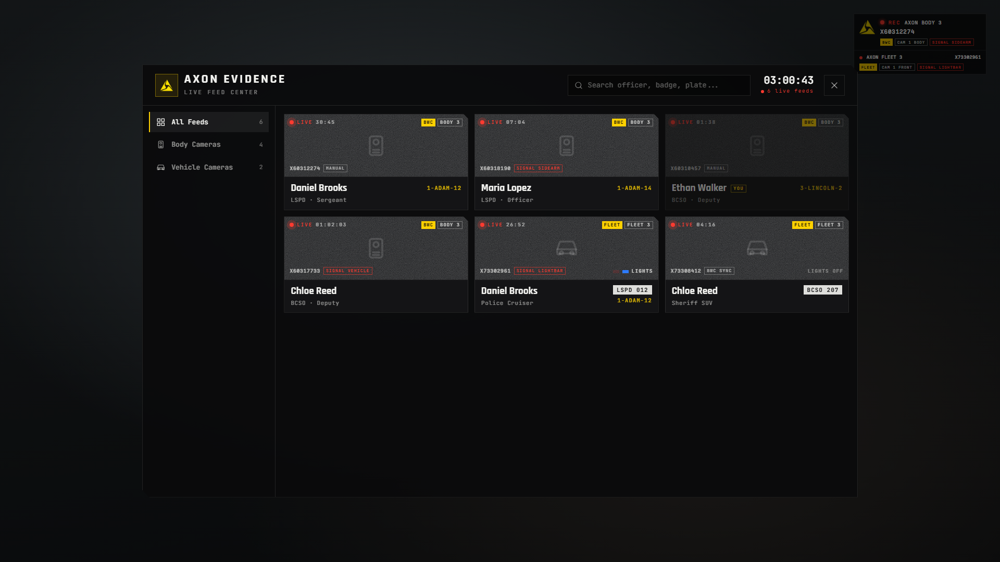</td>
    <td width="50%">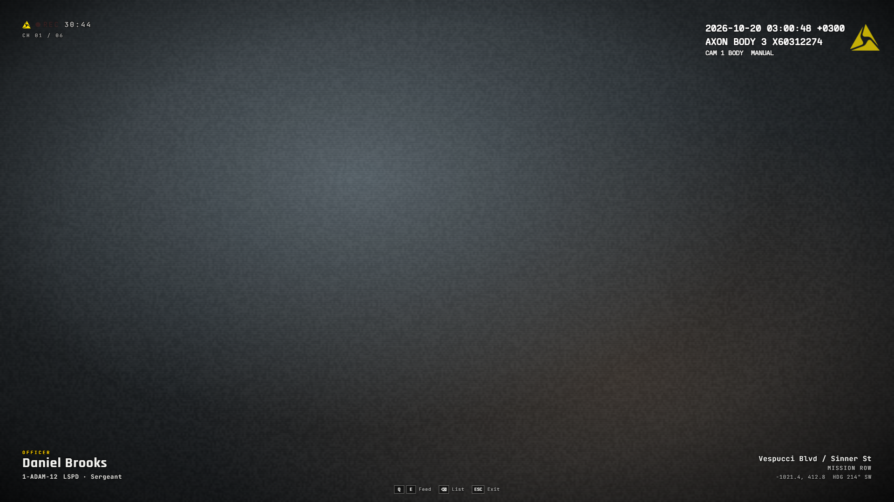</td>
  </tr>
  <tr>
    <td align="center"><sub>Live feed center</sub></td>
    <td align="center"><sub>Bodycam feed</sub></td>
  </tr>
  <tr>
    <td></td>
    <td>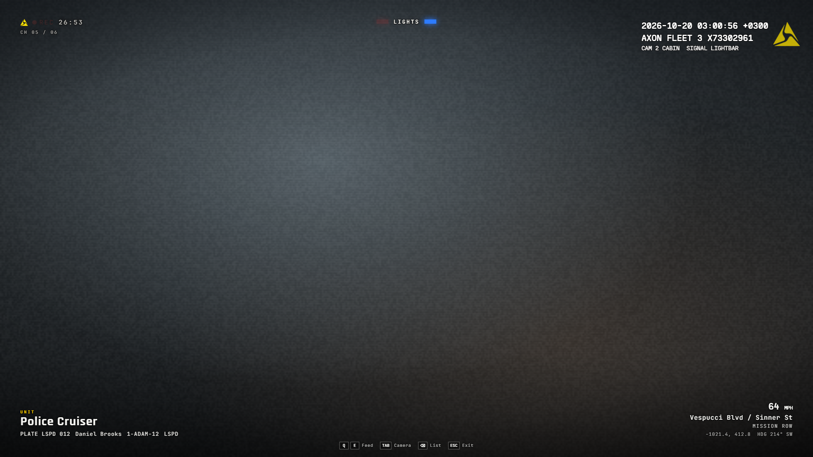</td>
  </tr>
  <tr>
    <td align="center"><sub>Dashcam, front camera</sub></td>
    <td align="center"><sub>Dashcam, cabin camera</sub></td>
  </tr>
</table>

<details>
<summary><b>More screenshots</b></summary>
<br>

<table>
  <tr>
    <td width="50%">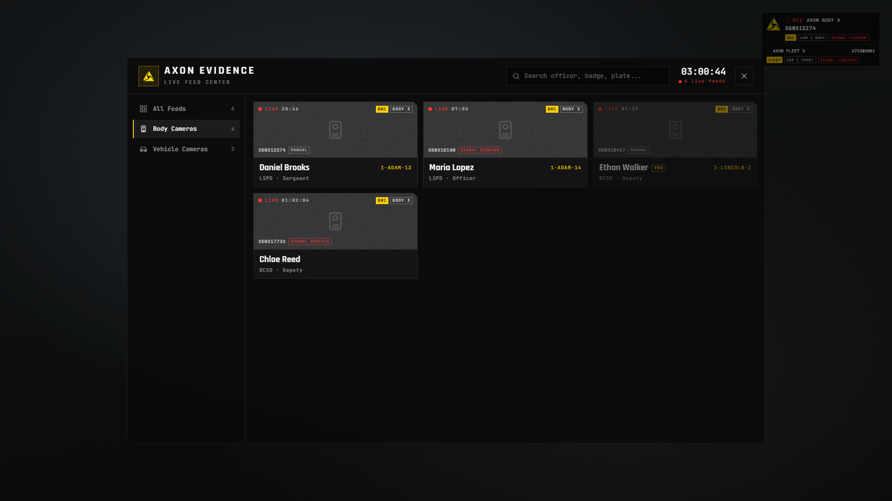</td>
    <td width="50%">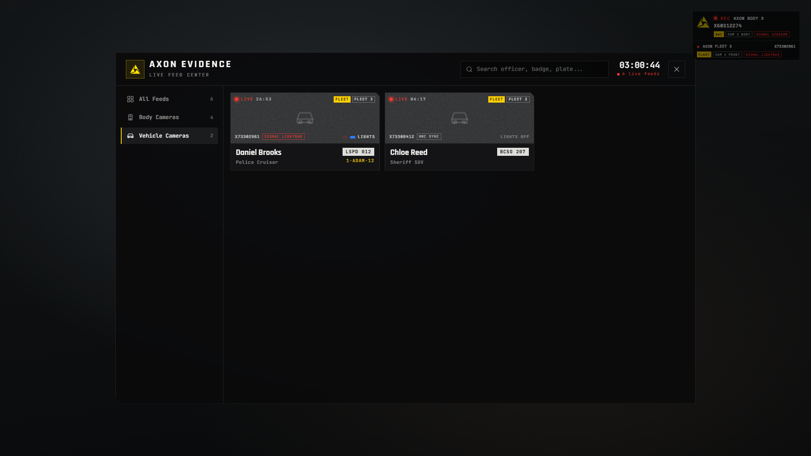</td>
  </tr>
  <tr>
    <td align="center"><sub>Body cameras filter</sub></td>
    <td align="center"><sub>Vehicle cameras filter</sub></td>
  </tr>
  <tr>
    <td>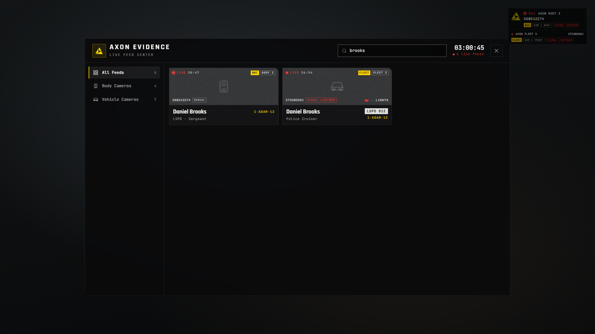</td>
    <td>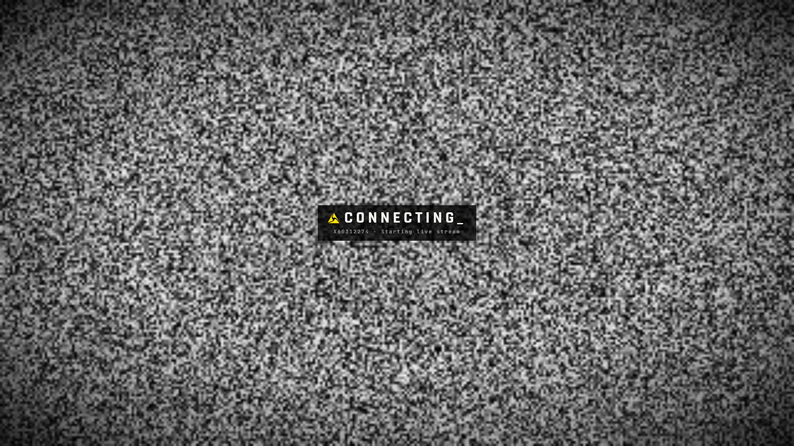</td>
  </tr>
  <tr>
    <td align="center"><sub>Search by officer, badge or plate</sub></td>
    <td align="center"><sub>Connecting to a feed</sub></td>
  </tr>
  <tr>
    <td>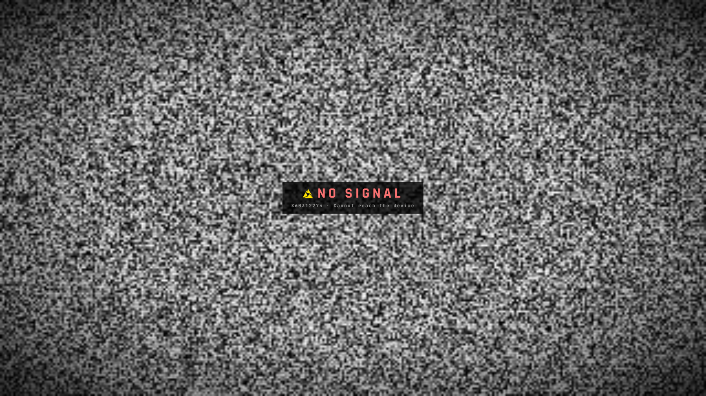</td>
    <td>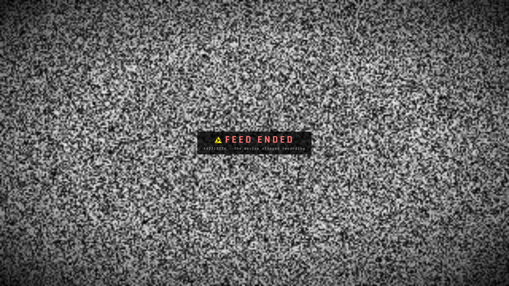</td>
  </tr>
  <tr>
    <td align="center"><sub>Signal lost</sub></td>
    <td align="center"><sub>Stream ended</sub></td>
  </tr>
  <tr>
    <td>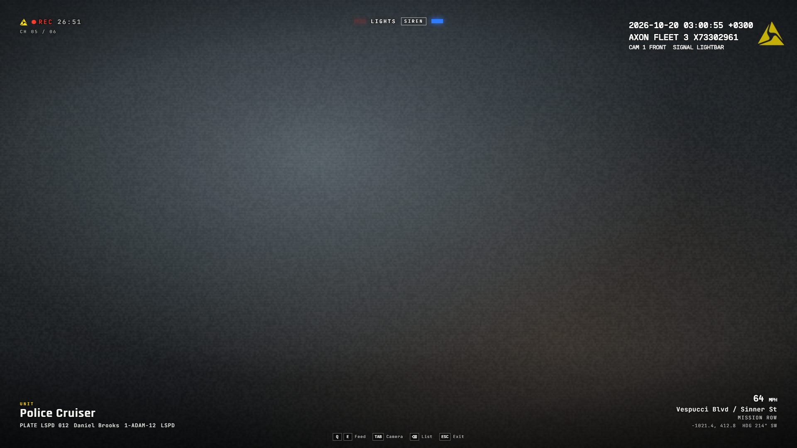</td>
    <td>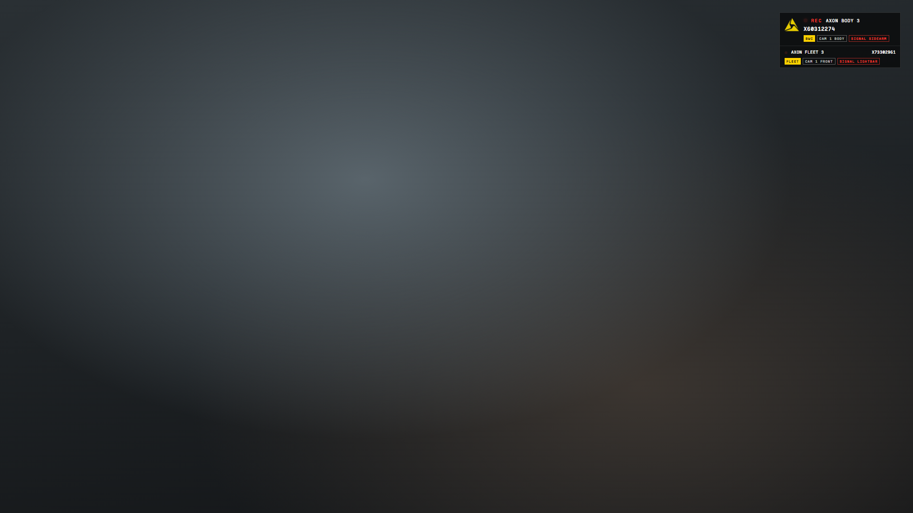</td>
  </tr>
  <tr>
    <td align="center"><sub>Dashcam with lights on</sub></td>
    <td align="center"><sub>Officer's recording indicator</sub></td>
  </tr>
</table>

</details>

## Requirements

| Type | Supported | Notes |
| --- | --- | --- |
| Required | [`ox_lib`](https://github.com/overextended/ox_lib/releases/latest) | The only hard dependency |
| Framework | `qbx_core`, `qb-core`, `es_extended` | Detected automatically |
| Inventory | `ox_inventory`, `qb-inventory`, `ps-inventory`, `codem-inventory`, `core_inventory`, `jpr-inventory`, `origen_inventory`, `tgiann-inventory` | Falls back to the framework inventory |
| Target | `ox_target`, `qb-target` | Needed for the station terminals |
| Notifications | `ox_lib`, `okokNotify`, `ps-ui` | Picked automatically or forced in the config |

> [!NOTE]
> A per-item serial number needs an inventory that stores item metadata (`ox_inventory`, `qb-inventory`).
> Elsewhere the serial is derived from the character, so it stays the same for every bodycam of one officer.

## Installation

> [!IMPORTANT]
> The resource folder **must** be named `hype-bodycam`. Under any other name the script stops itself and prints a warning.

**1. Download** or clone this repository and place it in your `resources` folder.

**2. Start it** in `server.cfg`, after its dependencies:

```cfg
ensure ox_lib
ensure qbx_core          # or qb-core / es_extended
ensure ox_inventory      # or qb-inventory
ensure ox_target         # or qb-target
ensure hype-bodycam
```

**3. Add the item** for your inventory (only one of them):

<details>
<summary><b>ox_inventory</b></summary>

Add to `ox_inventory/data/items.lua`:

```lua
['bodycam'] = {
    label = 'Axon Body 3',
    weight = 250,
    stack = false,
    close = true,
    description = 'Police body-worn camera. Use it to start or stop recording.',
    client = {
        export = 'hype-bodycam.bodycam',
    },
},
```

Copy `INSTALL/item-images/bodycam.png` to `ox_inventory/web/images/`.

</details>

<details>
<summary><b>qb-inventory / ps-inventory</b></summary>

Add to `qb-core/shared/items.lua`:

```lua
bodycam = {
    name = 'bodycam',
    label = 'Axon Body 3',
    weight = 250,
    type = 'item',
    image = 'bodycam.png',
    unique = true,
    useable = true,
    shouldClose = true,
    combinable = nil,
    description = 'Police body-worn camera. Use it to start or stop recording.',
},
```

Copy `INSTALL/item-images/bodycam.png` to `qb-inventory/html/images/`.

</details>

<details>
<summary><b>es_extended (no inventory resource)</b></summary>

Run [`INSTALL/esx.sql`](INSTALL/esx.sql) on your database. It also contains an alternative insert for older ESX versions that use a `limit` column.

Copy `INSTALL/item-images/bodycam.png` into your inventory resource's image folder.

</details>

**4. Configure** `config/config.lua`: at least the job groups and terminal coordinates (see below).

**5. Set the language** (`en` and `tr` included, add more in `locales/`):

```cfg
setr ox:locale "en"
```

A detailed setup and troubleshooting guide (Turkish) is available in [`INSTALL/README.md`](INSTALL/README.md).

## Configuration

Everything lives in [`config/config.lua`](config/config.lua). The most important options:

| Option | Description |
| --- | --- |
| `Item` | Item name, must match the one you added to your inventory |
| `Access` | Jobs and minimum grades allowed to wear a bodycam, plus the duty requirement |
| `ViewAccess` | Jobs allowed to watch feeds, and an ace that bypasses the job check |
| `Terminals` | Station computers where feeds can be watched |
| `Command` | Optional command that opens the feed list (`false` = terminals only) |
| `Bodycam` / `Dashcam` | Camera offsets, pitch and FOV, dashcam vehicle classes, models and exclusions, cabin camera |
| `Signal` | Automatic recording on weapon draw and on emergency lights |
| `Beep` | Recording beep interval, hearing range and volume |
| `Filter` | Picture effect (timecycle modifier) and its strength |
| `UI` | Timezone, date locale, `kmh` / `mph`, REC indicator and its position |

<details>
<summary><b>Example: access and terminals</b></summary>

```lua
Access = {
    groups = { police = 0, bcso = 0 },   -- job name -> minimum grade
    requireDuty = true,
},

ViewAccess = {
    groups = { police = 0, bcso = 0 },
    requireDuty = true,
    ace = "group.admin",                 -- false = disabled
},

Terminals = {
    { coords = vec3(441.85, -978.92, 30.69), radius = 0.8, label = "Mission Row PD" },
    { coords = vec3(1853.18, 3689.62, 34.27), radius = 0.8, label = "Sandy Shores Sheriff" },
    { coords = vec3(-448.29, 6011.95, 31.72), radius = 0.8, label = "Paleto Bay Sheriff" },
},
```

</details>

## Controls

While watching a feed:

| Key | Action |
| --- | --- |
| <kbd>Q</kbd> / <kbd>E</kbd> or <kbd>←</kbd> / <kbd>→</kbd> | Previous / next feed |
| <kbd>TAB</kbd> | Switch between front and cabin camera (dashcam) |
| <kbd>Backspace</kbd> | Back to the feed list |
| <kbd>ESC</kbd> | Close the viewer |

## Developers

All exports are called through `exports["hype-bodycam"]`. Full reference in [`exports.md`](exports.md).

| Export | Side | Description |
| --- | --- | --- |
| `IsBodycamOn()` | client | Whether the local player's bodycam is recording |
| `Open()` / `Close()` | client | Open or close the feed list (e.g. from an MDT or tablet) |
| `IsOpen()` | client | Whether the viewer is open |
| `GetViewingStream()` | client | ID of the feed being watched |
| `IsBodycamActive(source)` | server | Whether a player's bodycam is recording |
| `SetBodycam(source, active)` | server | Turn a player's bodycam on or off |
| `GetStreams()` | server | All active feeds |
| `GetViewers(id?)` | server | Players watching a feed, or any feed |

```lua
-- Server: log every recording
AddEventHandler("hype-bodycam:server:streamStarted", function(stream) end)
AddEventHandler("hype-bodycam:server:streamStopped", function(stream, reason) end)

-- Both sides: live list of active feeds (read only)
local streams = GlobalState["hype-bodycam:streams"]
```

<details>
<summary><b>Building the UI</b></summary>

The interface ships prebuilt in `web/build`. To modify it, edit the Vue source in `web/` and rebuild:

```bash
cd web
pnpm install
pnpm build
```

</details>

## License

Released under the [MIT License](LICENSE).

<div align="center">
<sub>Made by <b>HypeScripts</b></sub>
</div>
